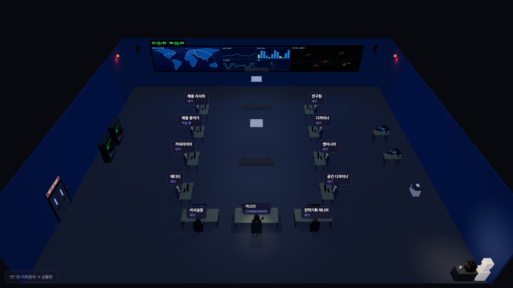
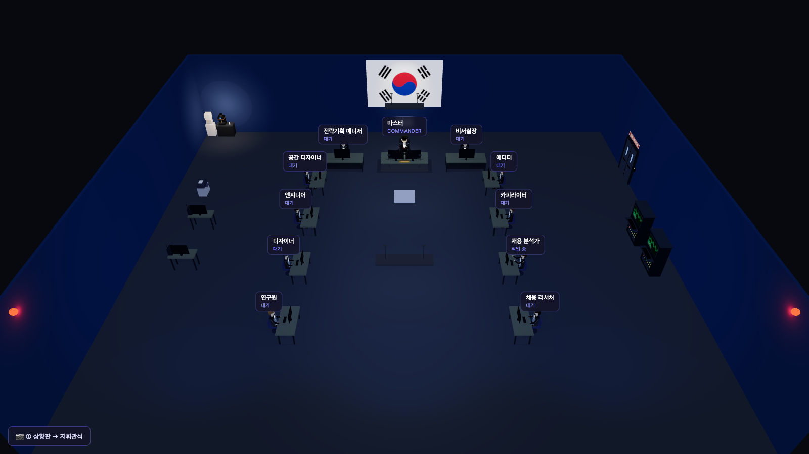

# 지휘통제실 AI 사무실 (agents-office-custom)

> 이 프로젝트는 [cernadasjuan/agents-office](https://github.com/cernadasjuan/agents-office)(MIT 라이선스)를 바탕으로 개조한 것입니다.
> 원본은 실행 중인 Claude Code 에이전트를 3D 사무실의 캐릭터로 보여 주는 프로그램이고, 이 저장소는 여기에 "지휘통제실" 테마를 새로 설계해 얹었습니다.




## 바꾼 것

**지휘통제실 테마** (왼쪽 아래 버튼으로 원래 사무실과 전환, 선택은 브라우저에 저장)

- **상황판**: 앞벽 전체를 덮는 24m × 3m 화면. 세계 항적 지도, 그래프, 위성 화면, 현재 시각이 나옵니다.
- **지휘관 책상**: U자 배치의 밑변 가운데에 있고, 모니터 2대와 COMMANDER 명패가 놓여 있습니다. 사용자 본인 캐릭터(마스터)가 항상 앉아 있고 스포트라이트를 받습니다.
- **직원 10명 상시 근무**: 원본은 "세션 1개 = 캐릭터 1명" 구조였습니다. 이것을 직원 10명이 항상 자리에 있고, 세션이나 서브 에이전트가 생기면 담당 직원이 그 일을 하는 구조로 바꿨습니다. 검토 작업은 참모 2명이 대기열로 나눠 맡습니다.
- **촬영 모드**: 📷 버튼을 누를 때마다 카메라가 ① 지휘관석 → 상황판, ② 상황판 → 지휘관석, ③ 위에서 내려다보는 화면 순서로 바뀝니다. 촬영 중에는 가리는 벽, 천장, UI를 숨깁니다. 위 캡처 두 장이 이 모드로 찍은 것입니다.
- 그 밖에 태극기, 정장 차림의 직원, 보안 철문, 분석 콘솔, 경광등, 한국어 활동 이름, 접히는 근무 현황 패널을 추가했습니다.

**작업 방식**: 먼저 [설계서.md](설계서.md)에 9단계 작업 계획과 위치·크기·색 기준값을 정했습니다. 그다음 단계마다 Claude Code에 프롬프트를 넣고, 설계서의 확인 기준대로 화면을 검증한 뒤 다음 단계로 넘어갔습니다. 막혔던 문제와 해결 과정도 설계서에 정리해 두었습니다.

## 수정 규모

원본 마지막 커밋(`88a04ae`) 대비, 소스 코드 기준입니다(`src/`, `server/`, `index.html`).

- 기존 파일 수정: **18개**
- 새 파일: **11개** (`Theme.ts`, `PhotoMode.ts`, `Commander.ts`, `Staff.ts`, `SuitFigure.ts`, `CommandScreens.ts`, `CommanderDesk.ts`, `ExecutiveDesk.ts`, `OfficeExtras.ts`, `Pantry.ts`, `Taegukgi.ts`)
- 변경량: **+2,476줄 / −158줄**
- 이 밖에 문서 `설계서.md`를 새로 썼습니다.

| 파일 | 역할 |
| --- | --- |
| `src/utils/Theme.ts` | 테마 색, 조명, 테마 전환 |
| `src/scene/Office.ts` | 가구·장비 배치, 활동 장소 |
| `src/characters/Staff.ts` | 직원 10명, 세션 연결, 검토 대기열 |
| `src/characters/Commander.ts` | 지휘관 캐릭터 |
| `src/scene/PhotoMode.ts` | 촬영 모드 |
| `server/agentDetector.ts` | 세션·에이전트 → 직책 이름 |

## 실행 방법

Node.js 18 이상이 필요합니다. Claude Code 세션이 실행 중이면 그 세션의 활동이 화면에 나타나고, 세션이 없어도 사무실과 직원은 보입니다.

```bash
git clone https://github.com/audxor0601/agents-office-custom.git
cd agents-office-custom
npm install
npm run dev
```

브라우저가 자동으로 열립니다. 왼쪽 아래 **테마 전환** 버튼으로 지휘통제실 테마를 켭니다.

**조작**: 화면 클릭 후 W/A/S/D로 이동, Space/Q로 위아래, Shift로 빠르게, 마우스로 시점 회전, Esc로 해제.

## 동작 원리 (원본과 같음)

```
~/.claude/sessions/*.json → Vite 미들웨어 → GET /api/agents → 브라우저가 3초마다 조회 → 3D 화면 갱신
```

서버는 내 컴퓨터의 Claude Code 세션 파일을 읽고, 대화 기록에서 최근에 쓴 도구(Read, Edit, Bash 등)를 보고 "조사 중", "작업 중", "테스트 중" 같은 활동을 정합니다. 화면은 Three.js로 그립니다.

## 라이선스

MIT. 원작자 Juan Cernadas의 저작권 표시는 [LICENSE](LICENSE)에 있습니다.
